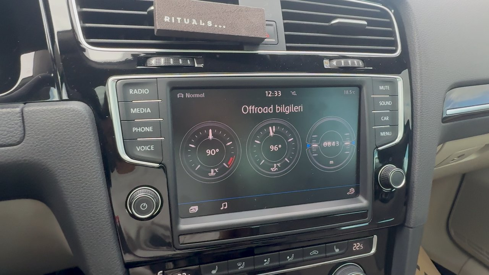

# MIB2 Offroad Temperature Gauges

Corrects **engine oil and coolant temperature readings** on the factory Offroad / Compass page. Offroad and Sport share the same temperature data, so one correction serves both screens. The compass, steering angle and altitude continue to use the original readings.



The earlier temperature fix worked in a 2015 Golf 7 with a **Delphi 874B**, software train **MST2_EU_VW_P0635D** and MU **0757**. The v0.2.0 installer was checked offline. Installation and rollback on Windows and on a live head unit remain untested.

## Fix the temperature readings

Use this release if your Offroad page already opens and both temperature readings need correction. If you already installed the Sport Gauges temperature corrections, Offroad uses them automatically. If your Sport setup is customized or only one temperature is wrong, use the Sport Gauges configurator to keep your existing settings and select only the correction you need. [Sport Gauges project](https://github.com/Victor-Unsullied/mib2-sports-gauges)

1. Download and extract the v0.2.0 ZIP on Windows with Python 3.10 or later. Double-click `Install.cmd`. The first run downloads and verifies the shared repair from GitHub. Keep an internet connection for that first run. [Offroad v0.2.0 prerelease](https://github.com/Victor-Unsullied/mib2-offroad-page-fixes/releases/tag/v0.2.0)
2. With the car parked and the head unit on stable power, check the unit’s model, Train and MU. Check for **D-Link DUB-E100** on the adapter plugged into the head unit and connect the Ethernet cable to your Windows computer. [D-Link connection guide](https://utkulekesiz.com/en/blog/mib2-dlink-connection/)
3. Choose English or Turkish and review the two temperature corrections. Confirm the unit and adapter, then enter the address shown in the unit’s Green Engineering Menu. Use the suggested **192.168.1.4** only if it matches. The wizard checks the direct Windows Ethernet route and asks for the unit’s existing FTP and Telnet service login details.
4. Follow the wizard’s backup, restart and verification prompts. Keep power and Ethernet connected through each check. After installation, open Offroad and check both readings as the engine warms up.

A failed installation can leave the head unit unusable. Read the wizard’s warning before confirming a write. Keep the entire installer folder, especially `state/temperature/`, which contains the private backups, logs and verified copy of the repair.

From PowerShell in the extracted folder, check the downloaded repair or preview the plan without contacting the car. Both commands can use the cached download on subsequent runs. Use `--inspect` to check a connected unit before deciding to install.

```powershell
py -3 -B install.py --check
py -3 -B install.py --plan
py -3 -B install.py --inspect
```

## Roll back the temperature repair

Use the same head unit and the original installer folder on Windows. The wizard asks for confirmation, restores the saved state and verifies the restart. Working service access is required.

```powershell
py -3 -B install.py --rollback
```

## Show the Offroad page if it is missing

The v0.1.0 ZIP changes page visibility only. Use it if you need to show the Offroad / Compass entry on the reviewed configuration. Use its own rollback command and saved state to restore the original menu setting. [Visibility release](https://github.com/Victor-Unsullied/mib2-offroad-page-fixes/releases/tag/v0.1.0) · [Visibility runbook for source checkouts](RUNBOOK.txt)

## Repair source

The Offroad release supplies the launcher and a profile with the two temperature corrections selected. The installer fetches the shared Sport Gauges recovery build at a specific commit and verifies its SHA-256 before running it. The Offroad ZIP contains no firmware. The shared installer creates its backups from the connected unit. [Pinned Sport Gauges recovery build](https://github.com/Victor-Unsullied/mib2-sports-gauges/tree/100c8b3617203f5706d968700329854160eaab9d)

Report results with your head-unit model, Train and MU. Keep the private state folder and credentials out of issue attachments. [Open an issue](https://github.com/Victor-Unsullied/mib2-offroad-page-fixes/issues/new/choose)
